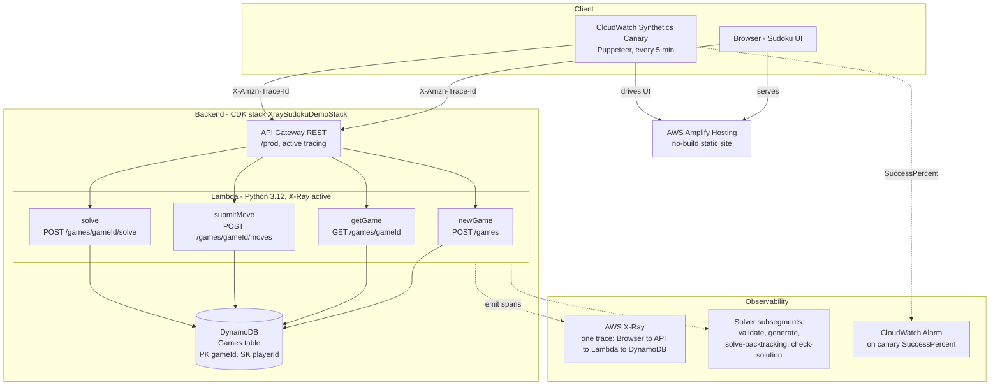

# X-Ray Sudoku Demo

An end-to-end AWS X-Ray distributed-tracing reference application. A browser-based
Sudoku game produces a single, coherent X-Ray trace that flows from the frontend
through every backend component — **Browser → API Gateway (REST) → Python Lambda →
DynamoDB** — including four custom subsegments recorded inside the Sudoku solver.
The game is fully playable and supports multiple concurrent users through a
client-generated `playerId`, with no Cognito and no managed authentication. It is
built as an observability workshop demo and deploys to region `us-east-1`.

## Architecture

The app is two halves that ship as one deployable solution:

- **Backend** — AWS CDK (Python 3.12) defining an API Gateway REST API (Lambda
  proxy integration), four Lambda functions, and a DynamoDB table, all with X-Ray
  active tracing. Stack name: `XraySudokuDemoStack`.
- **Frontend** — a no-build static site (plain HTML/CSS/JS) in `frontend/`, hosted
  on AWS Amplify Hosting and connected **manually via the Amplify console** (it is
  not defined in CDK). Each browser mints a `playerId` UUID into `localStorage` to
  separate users.

Also included: a CloudWatch Synthetics browser (Puppeteer) canary that drives the
live UI every 5 minutes with X-Ray active tracing, plus a CloudWatch alarm on the
canary `SuccessPercent` metric. Cost-allocation tags (`Project=xray-sudoku-demo`,
`ManagedBy=cdk`) are applied to all resources.



Every request from the browser or the canary flows through API Gateway, a Lambda, and DynamoDB as a single X-Ray trace, with the solver's four named subsegments visible inside the Lambda.

### API routes

The base URL is the `API_Endpoint_URL` CfnOutput emitted by `cdk deploy`
(e.g. `https://<id>.execute-api.us-east-1.amazonaws.com/prod/`).

| Method & path | Purpose | Errors |
|---|---|---|
| `POST /games` | Start a new game (body carries `playerId`); returns `gameId` + initial board | — |
| `GET /games/{gameId}` | Fetch a game (`playerId` via query/header) | 404 if absent |
| `POST /games/{gameId}/moves` | Submit a move | 400 invalid move, 404 if game absent |
| `POST /games/{gameId}/solve` | Solve the board; returns completed board or a no-solution response | — |

Every response — including 400 and 404 — carries CORS headers scoped to the
Amplify origin.

## Prerequisites

- **devbox** and **direnv** are **host prerequisites**, not project packages
  (devbox cannot install itself, and direnv must be on the shell before you enter
  the directory). Install direnv once with `devbox global add direnv` and hook it
  into your shell.
- AWS credentials are needed only to deploy and to run the live/operational
  recipes. This repo uses AWS SSO profile `Walsen`, region `us-east-1`. The test
  suite needs none.

The project toolchain is pinned in `devbox.json` (exact versions, `devbox.lock`
committed): `python@3.12.14`, `uv@0.12.5`, `just@1.58.0`, `jq@1.8.2`,
`yq-go@4.53.3`, `aws-cdk-cli@2.1138.0`, `awscli2@2.35.11`, `git@2.55.0`,
`gh@2.98.0`.

## Setup

1. Install **devbox** and **direnv** on the host (see Prerequisites).
2. In the repo, run `direnv allow` so the toolchain activates on `cd` (or use
   `devbox shell`).
3. Run `uv sync` to create the project virtual environment from `uv.lock`.

Python dependencies are owned by uv (`pyproject.toml` + `uv.lock`, both committed).
Runtime deps: `aws-cdk-lib`, `aws-xray-sdk`, `boto3`, `constructs`. Dev deps:
`hypothesis`, `mypy`, `pytest`, `ruff`. The dividing line is **import vs invoke** —
`aws-cdk-lib`/`boto3` are imported so they live in uv, while `aws-cdk-cli`/`awscli2`
are invoked so they live in devbox.

## Command surface

`just` is the single documented way to run each task, so a contributor and CI
invoke the same code path. Run recipes inside the devbox environment.

| Recipe | Purpose | Needs |
|---|---|---|
| `just test` | Run the pytest suite. Fully offline — no AWS creds, no network beyond localhost; includes CDK synth and assertions over the synthesized template. | offline |
| `just lint` | Lint with `ruff check`. | offline |
| `just typecheck` | Static type-check the backend with `mypy`. | offline |
| `just synth` | Synthesize the CloudFormation template (`cdk synth`), resolving nothing from an account. | offline |
| `just build-layer` | Build the `aws-xray-sdk` Lambda layer. | PyPI (not part of offline test) |
| `just deploy` | Build the layer, then `cdk deploy`. Emits the `API_Endpoint_URL` output. | AWS creds |
| `just verify-trace` | Drive the live API and assert one end-to-end X-Ray trace. | AWS creds + network |
| `just player-stats` | Report distinct players / games from DynamoDB. | AWS creds |
| `just error-report` | Report the demo's recent X-Ray faults/errors and the canary alarm state, each with a clickable console URL. | AWS creds + network |

`just verify-trace`, `just player-stats`, and `just error-report` are explicitly
outside the offline `just test` suite.

## Deploy / handoff

Deploying needs AWS credentials (this repo uses SSO profile `Walsen`, region
`us-east-1`).

1. Run `just deploy` — optionally with CDK context for CORS and the canary:
   `-c allowed_origin=<amplify-url> -c canary_target_url=<amplify-url>`. It emits
   the `API_Endpoint_URL` CfnOutput. The canary is only created when
   `canary_target_url` context is supplied.
2. Set that API URL as an Amplify configuration/env value that the frontend's
   `config.js` reads, and connect the `frontend/` folder in the Amplify console
   (`main` → production, `feature/*` → previews).
3. CORS `allowed_origin` and the canary target URL are supplied via CDK context
   (`-c`), never hardcoded.

**Tear down** with `cdk destroy --app "uv run python backend/app.py"`. This removes
the backend stack only — the Amplify app is not in CDK, so delete it separately in
the Amplify console.

## Repository structure

```
.
├── backend/                 # Python backend & infra
│   ├── app.py               # CDK app entry (pins us-east-1, applies cost tags)
│   ├── domain/              # Sudoku board, solver, tracer abstraction — pure, no AWS
│   ├── data/                # DynamoDB repository
│   ├── handlers/            # 4 Lambda handlers + responses/CORS + JSON logging
│   ├── infra/               # sudoku_stack.py CDK stack
│   │   └── canary/          #   sudoku_canary.js — Puppeteer canary script
│   └── tests/               # pytest + hypothesis (offline)
├── frontend/                # no-build static site
│   ├── index.html
│   ├── styles.css
│   ├── app.js
│   └── config.js
├── scripts/                 # operational scripts
│   ├── error_report.py
│   ├── player_stats.py
│   └── verify_trace.py
├── .kiro/                   # specs, steering, skills, hooks, settings/mcp.json
├── devbox.json
├── devbox.lock
├── .envrc
├── Justfile
├── pyproject.toml
├── uv.lock
├── amplify.yml              # Amplify monorepo build spec (appRoot frontend)
└── LICENSE
```

## Testing & practices

Development is test-driven: `pytest` pins concrete cases and error paths, and
`hypothesis` asserts the correctness properties the specs name — generated puzzles
have a unique solution, a given seed reproduces the same puzzle, valid boards stay
valid, and invalid moves are always rejected. The whole `just test` suite runs
offline with no AWS credentials and no network beyond localhost, including CDK
synthesis and the assertions over the synthesized template.

- **Determinism** — the solver and generator take an injected, seeded RNG; the
  clock and id source are injected too, so tests pin timestamps and `gameId`s
  rather than asserting around the wall clock.
- **Least-privilege IAM per Lambda** — each function gets only the DynamoDB actions
  it performs, plus X-Ray write.
- **Isolation** — every item access is scoped to the `(gameId, playerId)` pair, so
  one player can never read or mutate another's game.
- **CORS** — locked to the Amplify origin, not `*`, on every response.

## Skills

Kiro agent skills live in `.kiro/skills/` and answer common operational questions
about the deployed demo:

- **check-canary** — canary / synthetics / uptime health and failure diagnosis
  (via the CloudWatch Application Signals MCP server).
- **show-traces** — recent X-Ray / Application Signals traces, latency, and faults
  across the request path.
- **get-cost** — the AWS cost of the demo via the Billing & Cost Management MCP
  `cost_explorer` tool (tag-primary and service-fallback modes).
- **get-players** — distinct players and games played, from a read-only DynamoDB
  scan via `just player-stats`.
- **get-errors** — current X-Ray faults/failed requests and canary failures, each
  with a clickable X-Ray console URL, scoped to the demo's own services (via the
  CloudWatch Application Signals MCP server, with `just error-report` as a script
  fallback).

### Hooks

A manually triggered agent hook lives in `.kiro/hooks/`:

- **Check for errors** — runs `just error-report` on demand from the Agent Hooks
  UI, surfacing the demo's current X-Ray faults and canary alarm state.

## Cost

The running demo costs pennies. Lambda, DynamoDB, API Gateway, and X-Ray are
typically within free tier; the canary (Synthetics runs every 5 minutes) and its S3
artifacts are the only real line items. Tag-based cost attribution
(`Project=xray-sudoku-demo`) requires the `Project` tag to be activated in the
Billing console and ~24h of backfill; until then, use the service-scoped fallback.

## License

See the [LICENSE](LICENSE) file at the repository root.
